# Visual Review & Manual Testing Report

> [!NOTE]
> **No additional source code changes, commits, or merges have been made.** All screenshots below were captured directly from the live running build on `feat/visual-redesign`.

---

## 1. Full-Page & Page Screenshots

### 1.1 Home Page — Desktop (`1440px` wide, full-page) & Mobile (`390px` wide, full-page)
````carousel
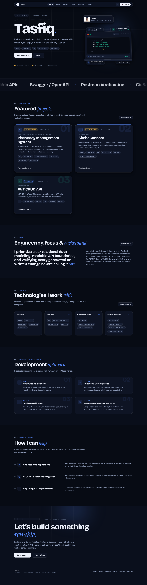
<!-- slide -->
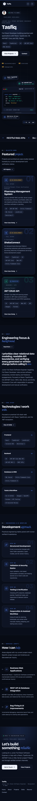
````

### 1.2 Projects Page, Project Details Page & About Page — Desktop (`1440px`)
````carousel
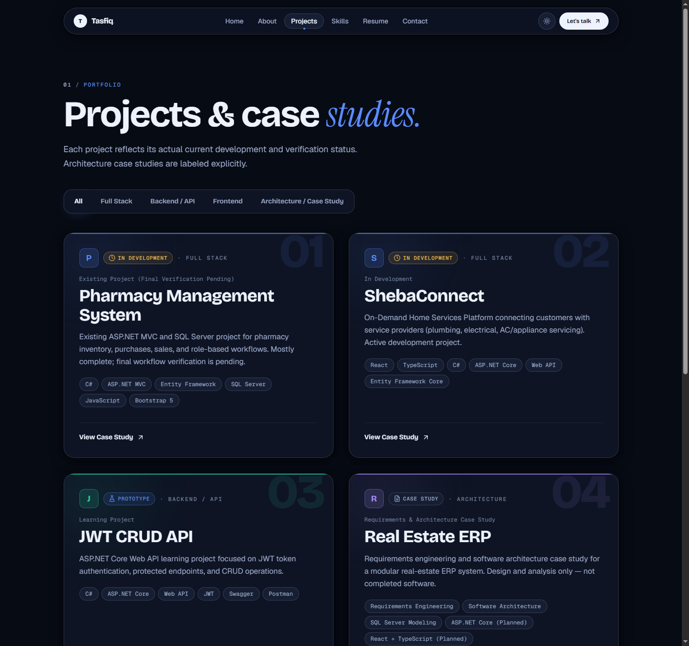
<!-- slide -->
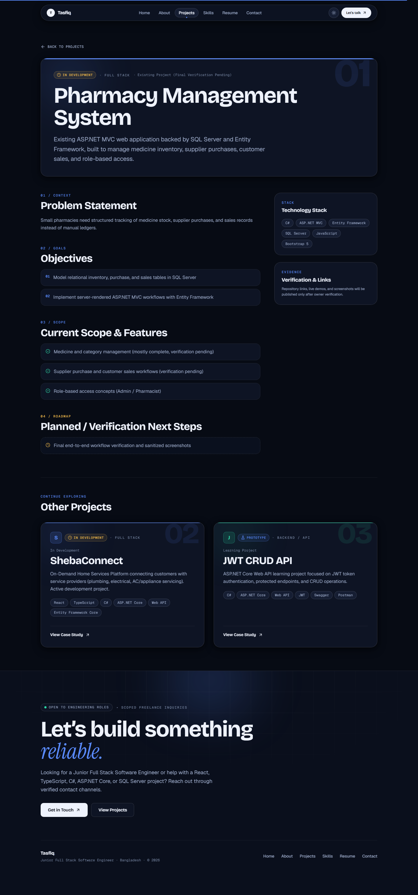
<!-- slide -->
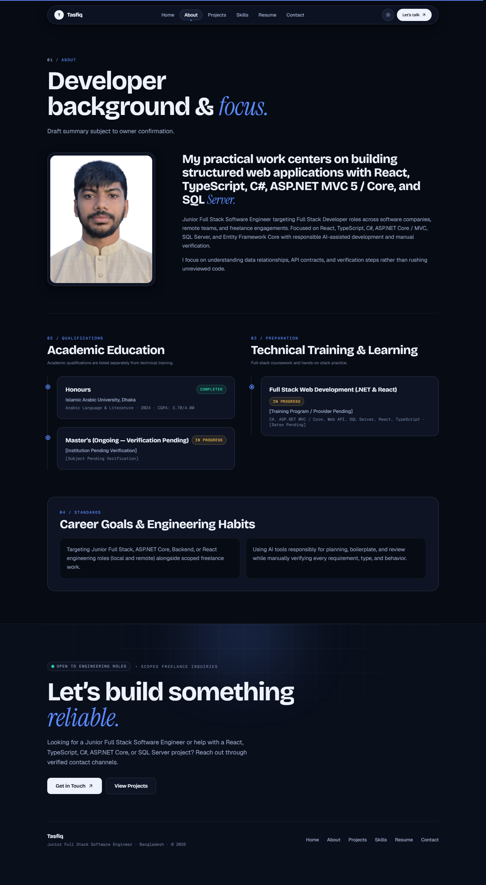
````

### 1.3 Dark vs. Light Theme Comparison (`1440×950`)
````carousel
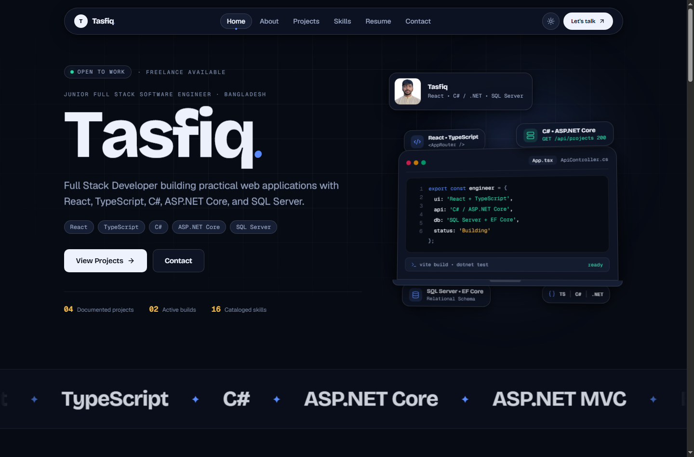
<!-- slide -->
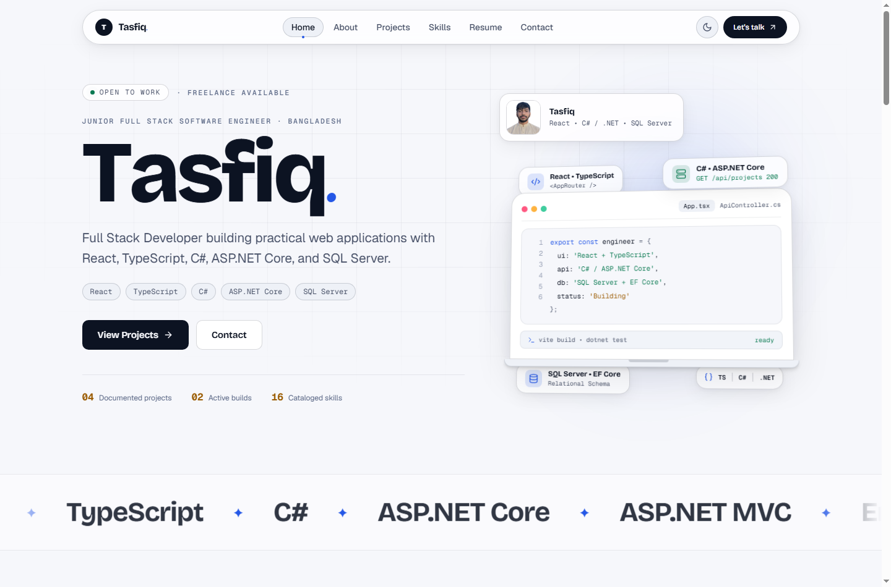
````

### 1.4 Component Close-Ups (Navbar, HeroScene, Project Card Hover Spotlight & Footer CTA)
````carousel
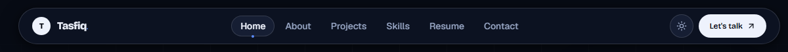
<!-- slide -->
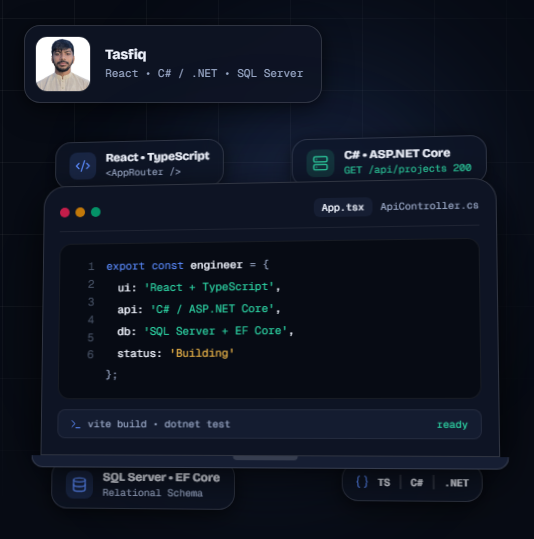
<!-- slide -->
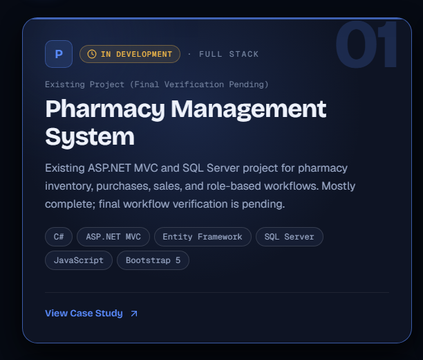
<!-- slide -->
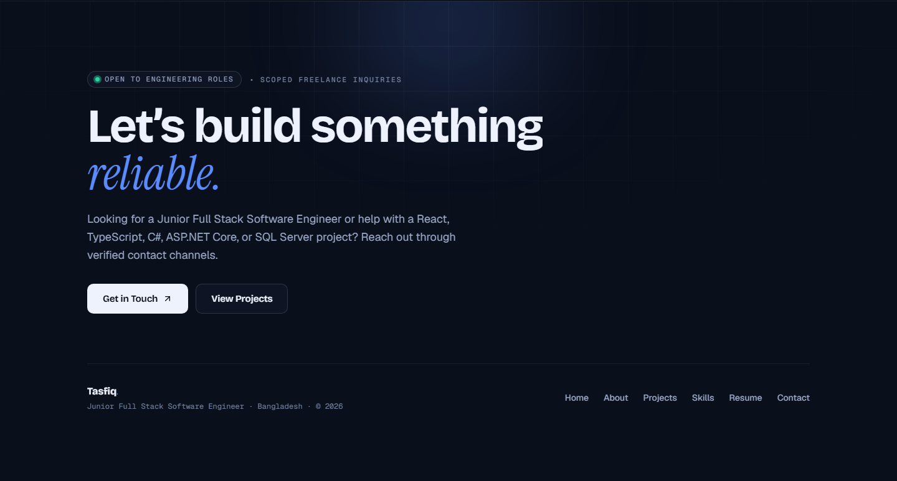
````

---

## 2. Manual Interaction Verification Results

| Interaction | How Verified | Result |
|---|---|---|
| **Desktop navigation & active link animation** | Navigated across `/`, `/about`, `/projects`, `/skills`, `/resume`, `/contact`; inspected active `NavLink[aria-current="page"]` | **Passed** — Active link renders both the shared `layoutId="nav-pill"` glass pill and `layoutId="nav-dot"` accent dot (`hasPillAndDot: true`), animating smoothly with spring physics (`400/32`). Navbar hides on downward scroll past `120px` and reappears on upward scroll. |
| **Mobile menu open, close & `Escape` key** | At `390×844`, clicked `button[aria-label="Open navigation menu"]`, checked focus & `body.style.overflow`, dispatched `Escape` `keydown` | **Passed** — Dialog `#mobile-navigation` opens (`dialogOpen: true`), locks page scroll (`bodyOverflow: "hidden"`), moves initial focus to `Close navigation menu`, renders all 6 indexed links (`01`–`06`), traps `Tab` focus inside the drawer, and closes cleanly on `Escape` (`dialogOpen: false`, `bodyOverflow: ""`). |
| **Dark / Light theme switching & persistence** | Clicked the header `ThemeToggle` button and inspected `localStorage`, `documentElement.classList`, and `<meta name="theme-color">` | **Passed** — Toggles from dark (`#070b14`) to light (`#f6f7fb`) with the circular View-Transition reveal (`::view-transition-new(root)`), persists `portfolio-theme` in `localStorage`, and restores before first paint via the inline `<head>` script in `index.html`. |
| **Project category filtering** | Clicked each segmented button (`All`, `Full Stack`, `Backend / API`, `Frontend`, `Architecture / Case Study`) on `/projects` | **Passed** — Active pill slides via `layoutId="project-filter-pill"` (`aria-pressed="true"`), and cards filter accurately: `All` (4), `Full Stack` (2: Pharmacy Management System, ShebaConnect), `Backend / API` (1: JWT CRUD API), `Frontend` (0 → displays empty-state message), `Architecture / Case Study` (1: Real Estate ERP). *(Note: during fast automated clicking, `AnimatePresence mode="popLayout"` briefly retains exiting nodes for `0.5s` while animating out.)* |
| **Project card hover effects** | Forced `:hover` pseudo-state and dispatched mouse pointer coordinates (`--mx: 240px`, `--my: 130px`) on `<article>` | **Passed** — Card lifts `-6px` (`-translate-y-1.5`), border brightens to `--card-accent`, ghost number (`01`) increases opacity from `10%` to `18%`, `.spotlight-layer` radial glow illuminates under the pointer, and the `View Case Study ↗` arrow nudges up-right. |
| **Scroll reveal & page transitions** | Walked full scroll height on desktop and mobile; navigated between routes | **Passed** — `<WordReveal>` headlines rise word-by-word from behind their mask, `<Reveal>` and `<Stagger>` sections fade and lift in once (`viewport.once = true`), top 2px `<ScrollProgress>` bar tracks scroll progress, and route changes fade/rise (`12px`, `0.45s`) while scrolling to top. |
| **Back-to-top button** | Scrolled to `window.scrollY = 650` and clicked `button[aria-label="Back to top"]` | **Passed** — Button fades in once `scrollY > 400` (`bttShown: true`) and returns viewport to `scrollY === 0` (`bttScrolledTop: true`) on click. |
| **Keyboard navigation & focus indicators** | Tabbed through skip link, navbar links, theme toggle, CTAs, and project cards | **Passed** — Skip-to-main-content pill appears at top-left on first `Tab`, and every interactive element displays a 2px `--accent` outline with `3px` offset on `:focus-visible`. |
| **`prefers-reduced-motion` behavior** | Enabled `prefers-reduced-motion: reduce` via Chrome DevTools Emulation and reloaded `/` | **Passed** — `window.matchMedia('(prefers-reduced-motion: reduce)').matches === true`; `<ScrollProgress>` unmounts (`scrollProgressHidden: true`); `<Reveal>`, `<Stagger>`, and `<WordReveal>` render static HTML without initial opacity/offset; marquee animation disables (`marqueeAnimationName: "none"`). |

---

## 3. Content & Data Integrity Audit

1. **Availability ("Open to work" / "Freelance available"):**
   - Directly bound to `PROFILE.availability.openToJobs` (`true`) and `PROFILE.availability.openToFreelance` (`true`) in [src/data/profile.ts](file:///E:/71%20Round/Portfolio/src/data/profile.ts#L14-L17).
   - Matches your stated career goal in `shortBio` (*"Junior Full Stack Software Engineer targeting Full Stack Developer roles across software companies, remote teams, and freelance engagements"*).
2. **Hero Metrics Verification (100% computed from actual data, zero hardcoded/invented numbers):**
   - **`04 Documented projects`** → `formatIndex(PROJECTS.length)` (Pharmacy Management System, ShebaConnect, JWT CRUD API, Real Estate ERP in [src/data/projects.ts](file:///E:/71%20Round/Portfolio/src/data/projects.ts)).
   - **`02 Active builds`** → `formatIndex(PROJECTS.filter((p) => p.status === 'in-progress').length)` (Pharmacy Management System + ShebaConnect).
   - **`16 Cataloged skills`** → `formatIndex(SKILLS.length)` (exact count of items in [src/data/skills.ts](file:///E:/71%20Round/Portfolio/src/data/skills.ts)).
3. **Honest Statuses & Conditional Links:**
   - Every project card and detail header displays its exact truthful status (`In Development`, `Prototype`, `Case Study`) — no project is marked `Completed`.
   - `PROFILE.email` is `undefined`, `PROFILE.resumeUrl` is `undefined`, and `SOCIAL_LINKS` is `[]`; therefore no `mailto:` buttons, CV download buttons, or social profile links render anywhere on the site, and the Contact/Resume pages display their honest verification notices.

